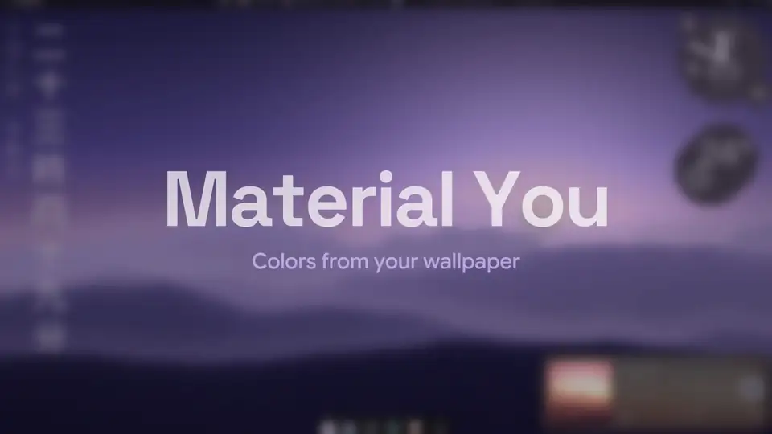

# ii-windows

**Illogical Impulse en Windows 11.** Un port de la interfaz de
[end-4/dots-hyprland](https://github.com/end-4/dots-hyprland) (Illogical Impulse) que corre de
verdad en Windows: el mismo QML de ii, sobre un fork de [Quickshell](https://quickshell.org)
compilado para Windows. No es una imitación ni un tema: es la shell de ii, con un backend nativo
para Windows debajo.

> Estado: en desarrollo activo. Funciona en el día a día del autor; lee [PROGRESS.md](PROGRESS.md)
> para ver qué está probado y qué falta.

> **Proyecto no oficial.** ii-windows no tiene relación con end-4 (Illogical Impulse) ni con
> outfoxxed (Quickshell), y ellos no lo apoyan ni lo mantienen. Está hecho con ayuda de IA
> (Claude Code y Codex) y Carlos responde por él. Los errores de ii-windows o del fork de
> Quickshell se reportan [aquí](https://github.com/TheCarlosS5/ii-windows/issues), **nunca** en
> los repositorios de dots-hyprland o de Quickshell. Este código tampoco se envía a esos proyectos.

*English summary at the end.*

<p align="center">
  
</p>

**Video de presentación:** [horizontal, 68 s](https://github.com/TheCarlosS5/ii-windows/releases/download/v0.1.1/ii-windows-promo-wide.mp4) ·
[vertical, 36 s](https://github.com/TheCarlosS5/ii-windows/releases/download/v0.1.1/ii-windows-promo-tall.mp4)

## Qué incluye

- **Barra** de ii con bandeja del sistema (iconos reales de tus apps, menús nativos), red, audio,
  multimedia, reloj y recursos. Las ventanas maximizadas respetan el espacio de la barra.
- **Lanzador y vista general** (tecla Windows / Win+Tab): búsqueda de apps, calculadora, emojis y
  las ventanas del escritorio actual con vista previa en vivo.
- **Escritorios virtuales de Windows** como los espacios de trabajo de ii: los puntitos de la barra
  son tus escritorios, y la vista general tiene una tira con todos ellos y *Nuevo escritorio*.
- **Dock** con vista previa de ventanas al pasar el ratón, botón de cerrar y menú de clic derecho.
- **Paneles laterales**: ajustes rápidos, notificaciones de Windows, calendario, tareas, pomodoro,
  mezclador de volumen, Wi-Fi, luz nocturna, planes de energía.
- **Escritorio de ii**: tus iconos reales (arrastrar, renombrar, copiar, papelera, menú de
  Explorer) y widgets: reloj, música con espectro, foto, clima, archivos recientes, calendario,
  tareas, temporizador, recursos, nota y reloj japonés. **Modo edición** (clic derecho > Editar
  escritorio): cuadrícula, arrastrar y cambiar el tamaño desde la esquina sin deformar.
- **Colores Material 3 desde el fondo** (la biblioteca oficial de Google), selector de fondos,
  fondo aleatorio. Windows sigue los colores de ii: modo oscuro/claro, color de acento y un esquema
  para Windows Terminal.
- **Notificaciones**, overlay (Super+G), recortes de pantalla con OCR, menú de sesión, cheatsheet.
- Fuentes, iconos y el cursor **Bibata** del dotfile. **Sonidos de la interfaz** propios.
- Se aparta de los juegos a pantalla completa.
- **fastfetch** con el logo de ii: escribe `fastfetch` en cualquier terminal (opcional al instalar).
- **Arranque**: al entrar en Windows ii carga con prioridad alta y tu fondo de ii aparece al
  momento (no se ve el fondo ni la barra de Explorer); luego vuelve a prioridad normal.

Lo que **no** hace: no gestiona ventanas (sin tiling), no emula Hyprland ni sus workspaces.
Windows sigue siendo Windows.

## Seguridad primero

Todo es por usuario y reversible. No inyecta nada en Explorer, no cambia `Winlogon\Shell`, no
escribe en `HKLM` ni modifica archivos del sistema. Lo único que pide permiso de administrador (una
vez, al instalar) es la **tarea programada "ii-windows"** que lo inicia al entrar; la tarea ejecuta
ii como tu usuario normal, sin permisos de administrador (la guarda el Programador de tareas de Windows; el desinstalador la quita). Si dices que no, se usa la clave `Run`
de tu usuario (arranca unos segundos más tarde).

- El instalador ofrece crear un **punto de restauración** y exporta a `.reg` cada clave que va a tocar.
- **Atajo de pánico: `Ctrl+Alt+Shift+R`**: cierra ii y devuelve la barra de tareas, los iconos y
  los colores de Windows.
- **Rescate**: menú Inicio > ii-windows > *Rescate de ii*. También funciona aunque ii esté colgado.
- Un proceso guardián restaura Windows si la shell muere.
- **Desinstalar** (menú Inicio o Configuración > Aplicaciones) deja Windows exactamente como estaba.

## Instalar

1. Descarga el `.zip` de la última versión en *Releases* y descomprímelo.
2. Doble clic en `install.cmd`. Pregunta antes de cada paso; pide administrador solo para el
   punto de restauración opcional y para crear la tarea de inicio.
3. ii arranca con Windows. Para quitarlo: *Desinstalar ii-windows*.

Requisitos: Windows 11 (probado en 24H2/25H2), x64.

## Reportar un problema

Menú Inicio > ii-windows > **Reportar un problema de ii**: guarda en tu Escritorio un archivo de
diagnóstico (sin tu nombre de usuario ni el de tu PC; es texto, puedes revisarlo) y abre el
[formulario de fallos](https://github.com/TheCarlosS5/ii-windows/issues/new/choose) con la versión
ya puesta. Arrastra el archivo al formulario y cuenta qué pasó. Las ideas también son bienvenidas.

## Compilar desde el código

Necesitas Visual Studio Build Tools 2022 (con clang-cl), Qt 6.12 MSVC y Python 3.

```powershell
git clone https://github.com/TheCarlosS5/ii-windows; cd ii-windows
git clone https://github.com/TheCarlosS5/quickshell-windows quickshell
git clone https://github.com/end-4/dots-hyprland upstream; git -C upstream checkout 33f31a08caddd41422a2d97670adeeb52b4f1e7c
. .\tools\dev\vsenv.ps1                                   # Qt desde $env:QTDIR
cmake -S quickshell -B quickshell\build -G Ninja; cmake --build quickshell\build
cmake -S host -B host\build -G Ninja; cmake --build host\build
.\tools\dev\stage-ii.ps1; .\tools\dev\deploy.ps1 -Full
.\tools\dev\fetch_fastfetch.ps1                           # fastfetch 2.69.0 (MIT), verificado
.\tools\package\make-package.ps1                          # out\ii-windows-<versión>.zip
```

Cómo está hecho: [docs/DECISIONS.md](docs/DECISIONS.md). Pruebas en Windows Sandbox:
`tools\sandbox\sbx.ps1` y `tools\sandbox\tests`.

## Créditos y licencias

- **Illogical Impulse** (diseño, módulos QML, recursos): [end-4](https://github.com/end-4) y
  colaboradores, GPL-3.0. Este port se distribuye bajo **GPL-3.0** (ver [LICENSE](LICENSE)). El QML
  de ii no se edita: se copia tal cual y se le aplican parches pequeños y explícitos
  (`tools/port/`) más archivos propios de Windows (`overlay/`).
- **Quickshell**: [outfoxxed](https://git.outfoxxed.me/quickshell/quickshell) y colaboradores,
  LGPL-3.0. El fork para Windows conserva esa licencia y su código está publicado en
  [TheCarlosS5/quickshell-windows](https://github.com/TheCarlosS5/quickshell-windows).
- **fastfetch** (fastfetch-cli, MIT), con un logo y una configuración propios de ii-windows.
- **material-color-utilities** (Google, Apache-2.0), **Bibata Modern Classic** (GPL-3.0), las
  fuentes e iconos del dotfile: sus licencias van incluidas en el paquete (`licenses/`).
- Hecho por Carlos con Claude Code (Anthropic) y Codex (OpenAI).

## English summary

ii-windows runs end-4's Illogical Impulse shell (Quickshell/QML) natively on Windows 11 through a
Windows port of Quickshell: bar with a real system tray, launcher and window overview, dock with
live previews, sidebars, notifications, desktop widgets, Material 3 colours from the wallpaper that
Windows' own theme follows, plus `fastfetch` with ii's logo. It doesn't manage windows. Everything is per-user and reversible
(restore point, `.reg` backups, panic hotkey `Ctrl+Alt+Shift+R`, rescue shortcut, clean uninstall).
GPL-3.0; Quickshell fork LGPL-3.0. Credits above.
To report a bug: Start menu > ii-windows > *Reportar un problema de ii* (diagnostics file without your
user name + the bug form), or [open an issue](https://github.com/TheCarlosS5/ii-windows/issues/new/choose).

**Unofficial project.** ii-windows is not affiliated with or endorsed by end-4 (Illogical Impulse)
or outfoxxed (Quickshell). It was built with AI assistance (Claude Code and Codex), and its author
is responsible for it. Please report bugs of ii-windows or of the Quickshell fork
[here](https://github.com/TheCarlosS5/ii-windows/issues), never to dots-hyprland or Quickshell.
None of this code is submitted to those projects.
